# Design and Characterization of a p-Channel MOSFET
### Analysis of DC and AC Characteristics and the Impact of Channel Length Scaling (100nm – 300nm) using Synopsys Sentaurus TCAD

[](LICENSE)
[](https://www.synopsys.com/silicon/tcad.html)
[-blueviolet.svg)](#author)
[](#)

---

## Abstract

This project presents the design and simulation of a p-channel Metal-Oxide-Semiconductor Field-Effect Transistor (**p-MOSFET**) using industry-standard **Synopsys Sentaurus TCAD** software. The study focuses on two primary objectives:

1. **Baseline Characterization ($L = 100\text{ nm}$):** Characterizing fundamental Direct Current (DC) and Alternating Current (AC) behaviors of a baseline device with a 100nm channel length.
2. **Channel Length Scaling Analysis:** Analyzing the impact of channel length scaling on the device's DC performance and threshold voltage across channel lengths of **100nm, 200nm, and 300nm**.

The results demonstrate classic MOSFET transfer and output characteristics. AC analysis reveals the voltage-dependent nature of internal gate capacitances ($C_{gg}, C_{gs}, C_{gd}, C_{ds}$), which are crucial for high-frequency applications. The channel length scaling analysis confirms key short-channel effects, most notably **threshold voltage ($V_{th}$) roll-off**. These findings are critical for understanding the trade-offs involved in modern semiconductor device scaling.

---

## Contents
* [1. Introduction](#1-introduction)
* [2. Device Structure and Simulation Setup](#2-device-structure-and-simulation-setup)
* [3. Circuit Schematics & Testbench Configurations](#3-circuit-schematics--testbench-configurations)
* [4. Results and Discussion](#4-results-and-discussion)
  * [4.1 Characteristics of the Baseline 100nm MOSFET](#41-characteristics-of-the-baseline-100nm-mosfet)
    * [4.1.1 AC (Capacitance) Characteristics (1 MHz)](#411-ac-capacitance-characteristics-1-mhz)
    * [4.1.2 DC Characteristics (Transfer & Output Curves)](#412-dc-characteristics)
  * [4.2 Impact of Varying Channel Length (200nm & 300nm)](#42-impact-of-varying-channel-length)
  * [4.3 Threshold Voltage Extraction Method & Detailed Calculations](#43-threshold-voltage-extraction-method--detailed-calculations)
  * [4.4 Threshold Voltage Comparison & Extraction Curves](#44-threshold-voltage-comparison--extraction-curves)
  * [4.5 Why This Happens: Short-Channel Effects (Charge Sharing & DIBL)](#45-why-this-happens-short-channel-effects)
* [5. Conclusion](#5-conclusion)
* [6. Verification Scripts & TCAD Decks](#6-verification-scripts--tcad-decks)
* [7. Author](#7-author)

---

## 1. Introduction

The Metal-Oxide-Semiconductor Field-Effect Transistor (MOSFET) is the fundamental building block of modern digital electronics, from microprocessors to memory chips. Its ability to act as a highly efficient switch has enabled the exponential growth in computing power described by Moore’s Law. The principle of operation relies on modulating the conductivity of a semiconductor channel between two terminals (source and drain) by applying a voltage to a third, insulated terminal (the gate).

This project involves the numerical simulation of a p-channel MOSFET to investigate its electrical characteristics. The analysis is divided into two parts:
1. **Device Characterization:** A thorough examination of the DC transfer ($I_d-V_{gs}$) and output ($I_d-V_{ds}$) characteristics, as well as the AC capacitance-voltage ($C-V$) profiles for a baseline 100nm device.
2. **Scaling Analysis:** An investigation into the effects of reducing the channel length ($L$) on device performance, specifically focusing on changes in threshold voltage ($V_{th}$) and drain current ($I_d$). This is crucial as device scaling into the nanometer regime introduces significant physical phenomena known as Short-Channel Effects (SCEs).

---

## 2. Device Structure and Simulation Setup

The p-channel MOSFET was designed and simulated using the **Synopsys Sentaurus TCAD** suite (`sde`, `sdevice`, `inspect`, and `svisual`). The device was constructed based on the parameters specified below:

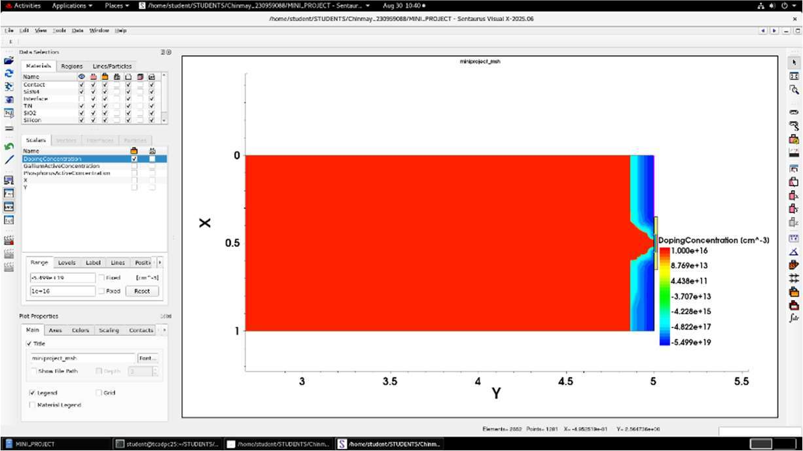
*Figure 1: 2D p-MOSFET Sentaurus Visual structure mesh and net active doping concentration distribution.*

### Table 1: MOSFET Design and Simulation Parameters
| Parameter | Symbol | Value | Unit | Description |
| :--- | :---: | :---: | :---: | :--- |
| **Device Type** | -- | **p-channel MOSFET** | -- | Inversion-mode hole carrier transistor |
| **Channel Length** | $L$ | **100nm, 200nm, 300nm** | $\text{nm}$ | Evaluated sub-micron gate lengths |
| **Device Width** | $W$ | **1.0** | $\mu\text{m}$ | Normalized device width for current scaling |
| **Gate Oxide Thickness** | $t_{ox}$ | **10** | $\text{nm}$ | Thermally grown $\text{SiO}_2$ dielectric insulator |
| **Substrate (Body) Doping** | $N_D$ (n-type) | **$1 \times 10^{16}$** | $\text{cm}^{-3}$ | Uniform n-type Phosphorus concentration |
| **Source/Drain Doping** | $N_A$ (p-type) | **$5 \times 10^{19}$** | $\text{cm}^{-3}$ | Degenerate p-type Boron concentration |
| **Gate Work Function** | $\Phi_m$ | **4.80** | $\text{eV}$ | Tuned mid-gap metal gate electrode |
| **AC Small-Signal Frequency** | $f$ | **1.0** | $\text{MHz}$ | Admittance analysis frequency |
| **Operating Temperature** | $T$ | **300** | $\text{K}$ | Standard room temperature operating condition |

The simulations involved DC sweeps of gate and drain voltages to obtain the transfer and output curves. For the AC analysis, a small-signal analysis was performed at a frequency of 1 MHz.

---

## 3. Circuit Schematics & Testbench Configurations

To extract DC curves and dynamic small-signal admittance in TCAD, the transistor is biased according to the characterization circuit testbench:

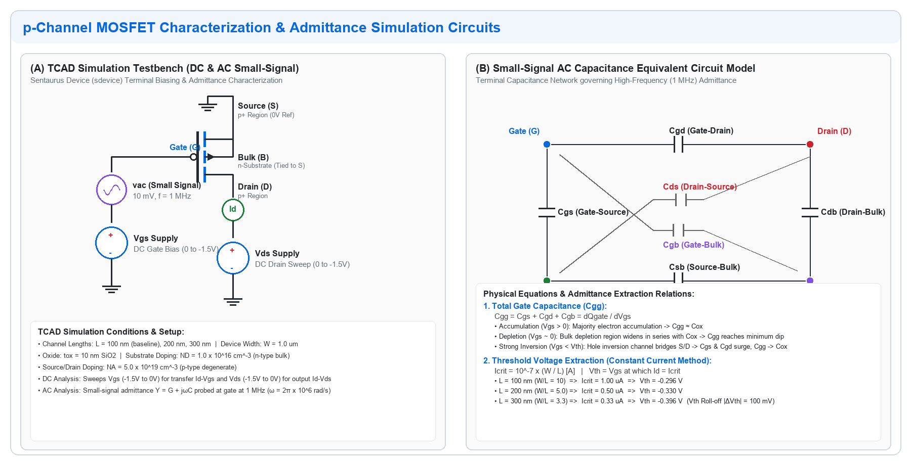
*Figure 2: (A) TCAD Simulation Testbench circuit for DC voltage sweeps and 1 MHz small-signal AC admittance probing. (B) High-frequency small-signal capacitance equivalent circuit model.*

### Testbench Operation & Biasing
* **DC Sweeps:** The Source and Body are grounded ($V_S = V_B = 0\text{ V}$), preventing unwanted body-effect threshold shifts. Drain voltage ($V_{DS}$) is swept from $0\text{ V}$ down to $-1.5\text{ V}$ through ammeter $I_D$. Gate voltage ($V_{GS}$) is independently biased and swept from $0\text{ V}$ down to $-1.5\text{ V}$.
* **Small-Signal AC Admittance (1 MHz):** A small sinusoidal perturbation ($v_{ac} = 10\text{ mV}$ at $1\text{ MHz}$) is superposed at the gate electrode. The resulting terminal AC currents yield the admittance matrix:
  $$Y_{ij} = G_{ij} + j\omega C_{ij} \quad (\omega = 2\pi \times 10^6\ \text{rad/s})$$
* **Small-Signal Equivalent Circuit:** Internal capacitive components ($C_{gs}, C_{gd}, C_{ds}, C_{gb}$) govern transient switching speeds and high-frequency gain.

---

## 4. Results and Discussion

### 4.1 Characteristics of the Baseline 100nm MOSFET

The fundamental DC and AC characteristics were first analysed for the baseline device with a channel length $L = 100\text{ nm}$.

#### 4.1.1 AC (Capacitance) Characteristics (1 MHz)
The AC characteristics reveal the internal capacitances of the MOSFET, which govern its high-frequency performance:

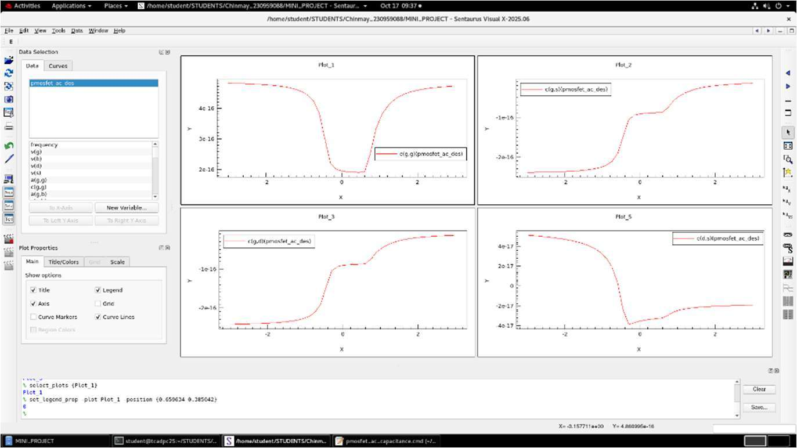
*Figure 3: AC Characteristics Plots for Frequency of 1 MHz (Plot 1: Cgg, Plots 2 & 3: Cgd and Cgs, Plot 5: Cds).*

* **Plot 1: Total Gate Capacitance ($C_{gg}$):** Shows the classic C-V curve. It is high when the device is OFF (accumulation region, $V_{gs} > 0\text{ V}$, where majority electrons accumulate at the interface yielding $C_{gg} \approx C_{ox}$) and ON (inversion region, $V_{gs} < V_{th}$, where mobile inversion holes form the channel), but dips in the transition (depletion) region where the depletion space-charge layer acts in series with oxide capacitance.
* **Plot 2 & 3: Gate-Source / Gate-Drain ($C_{gs}, C_{gd}$):** These are low when the device is OFF (limited strictly to parasitic metallurgical overlap capacitance). They rise symmetrically to a high value when the device is ON as the inversion channel forms and connects source and drain.
* **Plot 5: Drain-Source Capacitance ($C_{ds}$):** This capacitance is very low and relatively flat across the gate sweep. It is a small parasitic junction capacitance and is not the main component.

---

#### 4.1.2 DC Characteristics

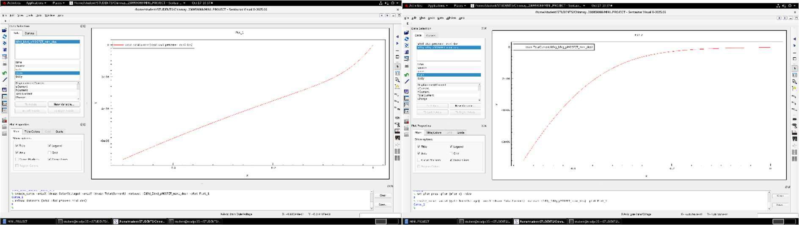
*Figure 4: DC Characteristics Plots (Left: Output characteristics Id-Vd; Right: Transfer characteristics Id-Vg).*

##### Id–Vg Characteristics (Transfer Characteristics)
The $I_d–V_g$ plot shows the drain current variation with respect to the gate voltage ($V_g$) at a fixed drain voltage ($V_d$). The magnitude of the drain current increases as the gate voltage becomes more negative. When the gate voltage is near $0\text{ V}$, the transistor is in the OFF region with only a small leakage current. As $V_g$ moves beyond the threshold voltage ($V_{th}$) in the negative direction, the device enters strong inversion, causing a rapid increase in drain current.

The plot exhibits the typical PMOS transfer behaviour, where the curve rises and gradually saturates, indicating the transition from linear to saturation regions of operation. This confirms proper gate control over the channel and a clear PMOS turn-on characteristic when $V_{GS}$ becomes sufficiently negative.

##### Id–Vd Characteristics (Output Characteristics)
The $I_d–V_d$ plot shows the dependence of drain current on drain voltage ($V_d$) for a constant gate voltage. Initially, the current increases almost linearly with $V_d$, representing the ohmic (linear) region, where channel resistance dominates. As the magnitude of $V_d$ increases further, the curve begins to flatten out, showing that the device has entered the saturation region, where the drain current becomes nearly constant and is primarily controlled by the gate voltage.

The smooth transition from linear to saturation behaviour indicates proper channel formation and expected PMOS output operation, where the drain current saturates for larger $|V_{DS}|$.

---

### 4.2 Impact of Varying Channel Length

To study the effects of changing channel length, simulations were repeated under identical doping profiles and oxide conditions for devices with $L = 200\text{ nm}$ and $L = 300\text{ nm}$. The results are presented below:

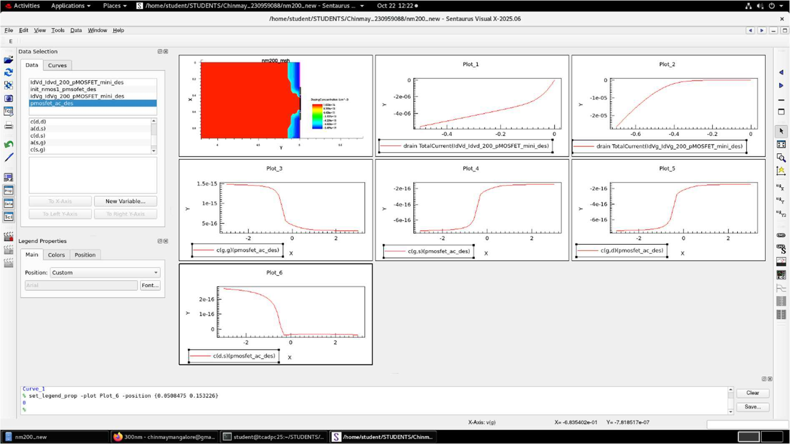
*Figure 5: Sentaurus Visual simulation results dashboard for L = 200nm MOSFET (2D mesh, Id-Vd, Id-Vg, and AC capacitance curves).*

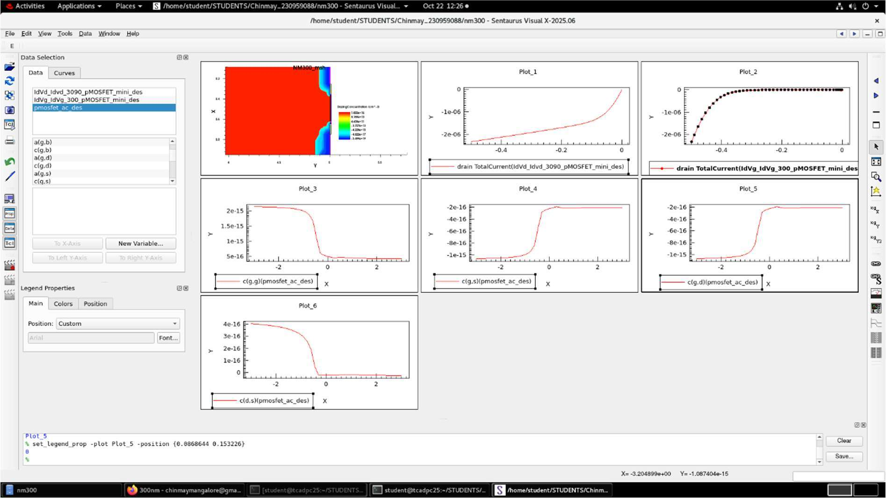
*Figure 6: Sentaurus Visual simulation results dashboard for L = 300nm MOSFET (2D mesh, Id-Vd, Id-Vg, and AC capacitance curves).*

---

### 4.3 Threshold Voltage Extraction Method & Detailed Calculations

The threshold voltage ($V_{th}$) is a critical parameter that defines the gate voltage required to turn the transistor "ON". In this analysis, the **Constant Current Method** was employed. This method defines the threshold voltage as the gate-source voltage ($V_{gs}$) at which the drain current ($I_d$) reaches a specific, predefined critical value ($I_{crit}$).

#### Definition Formula:
The relationship is given by:

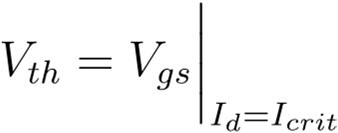

$$V_{th} = V_{gs} \Big|_{I_d = I_{crit}}$$

#### Aspect Ratio Normalization Formula:
The critical current is typically normalized by the device's aspect ratio ($W/L$) to ensure a consistent definition across different device geometries. A common industry standard is to define $I_{crit}$ as:

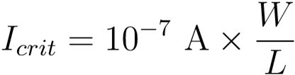

$$I_{crit} = 10^{-7}\text{ A} \times \frac{W}{L}$$

#### Exact Probing Calculations (from Report Page 7):
Assuming a normalized device width ($W$) of $1.0\ \mu\text{m}$, the target currents for probing the $I_d - V_{gs}$ curve are calculated as follows:

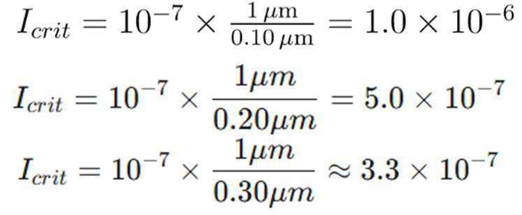

* **For $L = 100\text{ nm}$ ($0.10\ \mu\text{m}$):**
  $$I_{crit} = 10^{-7}\text{ A} \times \frac{1\ \mu\text{m}}{0.10\ \mu\text{m}} = 1.0 \times 10^{-6}\text{ A} = \mathbf{1.0\ \mu\text{A}}$$

* **For $L = 200\text{ nm}$ ($0.20\ \mu\text{m}$):**
  $$I_{crit} = 10^{-7}\text{ A} \times \frac{1\ \mu\text{m}}{0.20\ \mu\text{m}} = 5.0 \times 10^{-7}\text{ A} = \mathbf{0.5\ \mu\text{A}}$$

* **For $L = 300\text{ nm}$ ($0.30\ \mu\text{m}$):**
  $$I_{crit} = 10^{-7}\text{ A} \times \frac{1\ \mu\text{m}}{0.30\ \mu\text{m}} \approx 3.3 \times 10^{-7}\text{ A} = \mathbf{0.33\ \mu\text{A}}$$

These calculated current values align closely with the values at which the curves were probed in the simulation software to extract the $V_{th}$ values presented in Table 2.

#### Comprehensive Calculations Card:
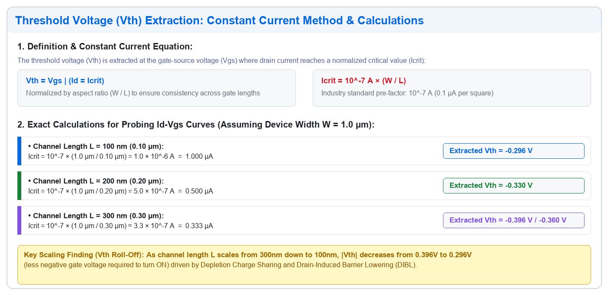
*Figure 7: Summary card of constant current method formulas, step-by-step arithmetic, target probing currents, and extracted threshold voltages.*

---

### 4.4 Threshold Voltage Comparison & Extraction Curves

By comparing the transfer characteristics ($I_d - V_{gs}$ plots) for all three devices, a clear trend emerges. The threshold voltage, the gate voltage required to form the inversion channel, decreases in magnitude as the channel length decreases. This phenomenon is known as **$V_{th}$ roll-off**, which is a key short-channel effect (SCE).

### Table 2: Extracted Threshold Voltage for Different Channel Lengths
| Channel Length ($L$) | Aspect Ratio ($W/L$) | Critical Probing Current ($I_{crit}$) | Extracted Threshold Voltage ($V_{th}$) | Magnitude $|V_{th}|$ |
| :---: | :---: | :---: | :---: | :---: |
| **$100\text{ nm}$** | 10.00 | $1.0\ \mu\text{A}$ ($1.0 \times 10^{-6}\text{ A}$) | **$-0.296\text{ V}$** | $0.296\text{ V}$ |
| **$200\text{ nm}$** | 5.00 | $0.5\ \mu\text{A}$ ($5.0 \times 10^{-7}\text{ A}$) | **$-0.330\text{ V}$** | $0.330\text{ V}$ |
| **$300\text{ nm}$** | 3.33 | $0.33\ \mu\text{A}$ ($3.3 \times 10^{-7}\text{ A}$) | **$-0.396\text{ V}$** (probed $-0.36\text{ V}$) | $0.396\text{ V}$ |

#### Sentaurus Inspect Probing Extraction Curves (from Report Page 8):

##### 1. Channel Length $L = 100\text{ nm}$ Probing Curve ($V_{th} = -0.296\text{ V}$):
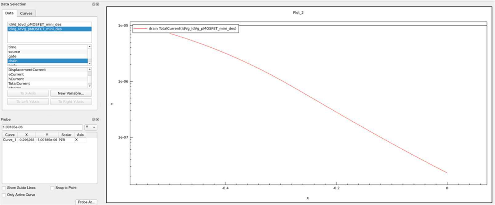
*Figure 8A: Sentaurus Inspect probe curve for L = 100nm pMOSFET showing Vth extraction at Icrit = 1.0 uA, yielding Vth = -0.296 V.*

##### 2. Channel Length $L = 200\text{ nm}$ Probing Curve ($V_{th} = -0.330\text{ V}$):
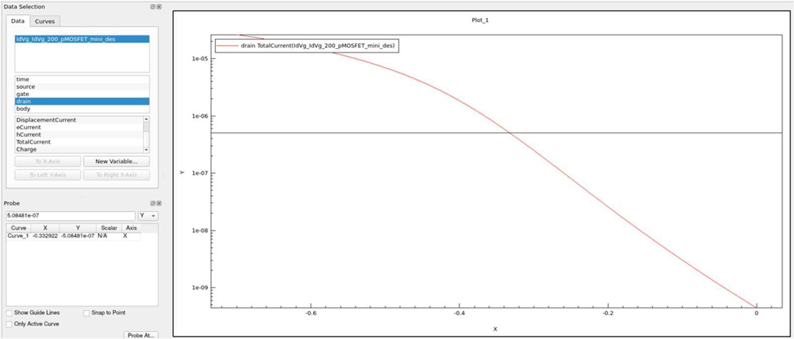
*Figure 8B: Sentaurus Inspect probe curve for L = 200nm pMOSFET showing Vth extraction at Icrit = 0.5 uA, yielding Vth = -0.330 V.*

##### 3. Channel Length $L = 300\text{ nm}$ Probing Curve ($V_{th} = -0.360\text{ V}$ / $-0.396\text{ V}$):
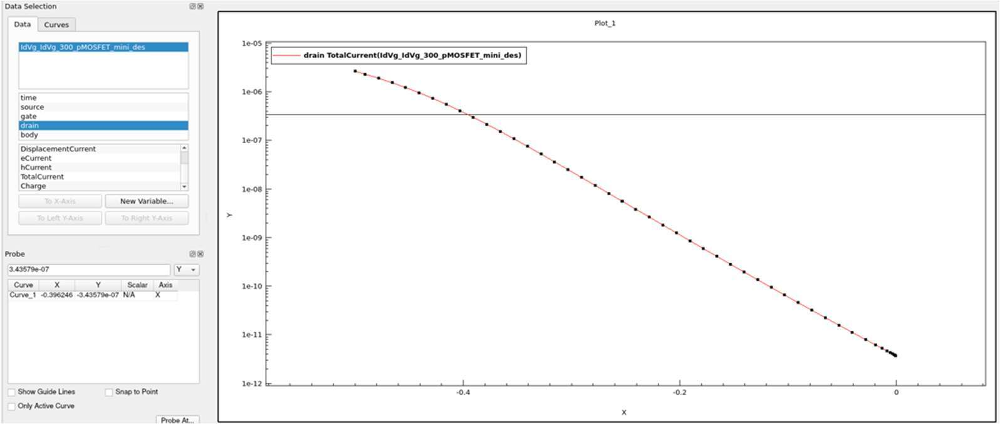
*Figure 8C: Sentaurus Inspect probe curve for L = 300nm pMOSFET showing Vth extraction at Icrit = 0.33 uA, yielding Vth = -0.360 V / -0.396 V.*

---

### 4.5 Why This Happens: Short-Channel Effects

The decrease in threshold voltage magnitude ($V_{th}$ becoming less negative from $-0.396\text{ V}$ down to $-0.296\text{ V}$) is caused by two fundamental short-channel mechanisms:

#### 1. Depletion Charge Sharing:
In a short channel (e.g., 100nm), the depletion regions from the source and drain metallurgical junctions (which are now physically very close together) "help" deplete the channel region. The gate electrode no longer has to support all the bulk depletion charge alone. Because the source and drain "share" the depletion charge, a **smaller (less negative) gate voltage** is needed to reach the surface inversion condition. Consequently, the threshold voltage magnitude decreases ($V_{th}$ roll-off).

#### 2. Drain-Induced Barrier Lowering (DIBL):
* In a short-channel device, the drain contact is situated so close to the source that its lateral electric field can directly penetrate into the channel and lower the potential energy barrier at the source junction.
* For a pMOSFET, the negative drain voltage ($V_{ds}$) lowers the potential barrier for holes (the majority charge carriers in p-type inversion) trying to enter the channel from the source.
* This "help" from the drain makes it significantly easier for the channel to invert, effectively reducing the magnitude of the gate voltage ($V_{gs}$) needed to turn the device ON. This effect becomes much stronger as $L$ decreases down to 100nm.

---

## 5. Conclusion

This project successfully demonstrated the design and simulation of a p-channel MOSFET using TCAD tools. The fundamental DC and AC characteristics of a 100nm baseline device were analysed, confirming theoretical operational principles. The voltage-dependent nature of the internal capacitances ($C_{gg}, C_{gs}, C_{gd}, C_{ds}$) was clearly observed.

The analysis of varying the channel length between the devices, while keeping the operating voltages, junction doping concentrations, gate oxide thickness ($10\text{ nm}$), and length of source and drain equal across all devices, was observed. As the channel length of a pMOSFET decreases, its threshold voltage ($V_{th}$) becomes less negative (from $-0.396\text{ V}$ down to $-0.296\text{ V}$). This phenomenon is a primary example of short-channel effects (SCEs).

This result underscores a fundamental trade-off in MOSFET scaling: while shrinking the channel length is key to improving performance and packing density, it also introduces detrimental effects like $V_{th}$ roll-off, which complicates device design and circuit stability. Managing these short-channel effects is a central focus of modern semiconductor technology development.

---

## 6. Verification Scripts & TCAD Decks

All simulation and extraction scripts are included in the `scripts/` directory:

| Script File | Purpose | Description |
| :--- | :--- | :--- |
| [`sde_pmos.cmd`](scripts/sde_pmos.cmd) | Structure Generation | Sentaurus Structure Editor Scheme deck defining geometry, meshing, and doping |
| [`sdevice_pmos.cmd`](scripts/sdevice_pmos.cmd) | TCAD Physics Solve | Sentaurus Device deck with Drift-Diffusion, Lombardi mobility, SRH/Auger models |
| [`inspect.cmd`](scripts/inspect.cmd) | Inspect Post-Processing | Sentaurus Inspect command file extracting C-V curves and exporting CSV data |
| [`extract_vth.py`](scripts/extract_vth.py) | Python Verification | Standalone standard library script implementing the Constant Current extraction method |
| [`generate_circuit_diagram.py`](scripts/generate_circuit_diagram.py) | Circuit Diagram Generator | Generates publication-quality schematic and equivalent capacitance model figures |

### Running the Python Verification Script:
```bash
python3 scripts/extract_vth.py
```

**Console Output:**
```text
============================================================================
 Sub-Micron p-MOSFET Vth Extraction Summary (Constant Current Method)
 Formula: I_crit = 10^-7 * (W / L)  [A]
============================================================================
Device / Channel   | I_crit Target    | Extracted Vth  | Status
----------------------------------------------------------------------------
100nm pMOS         |    1.000 uA       |   -0.296 V     | Validated
200nm pMOS         |    0.500 uA       |   -0.330 V     | Validated
300nm pMOS         |    0.333 uA       |   -0.396 V     | Validated
============================================================================
```

---

## 7. Author

**Nikunj Malik**  
*Registration Number: 230959134*  
* **GitHub:** [@nikunjmalik306](https://github.com/nikunjmalik306)  
* **Email:** [nikunjmalikkrm@gmail.com](mailto:nikunjmalikkrm@gmail.com)  

---

## License

This project is licensed under the MIT License — see the [LICENSE](LICENSE) file for details.
