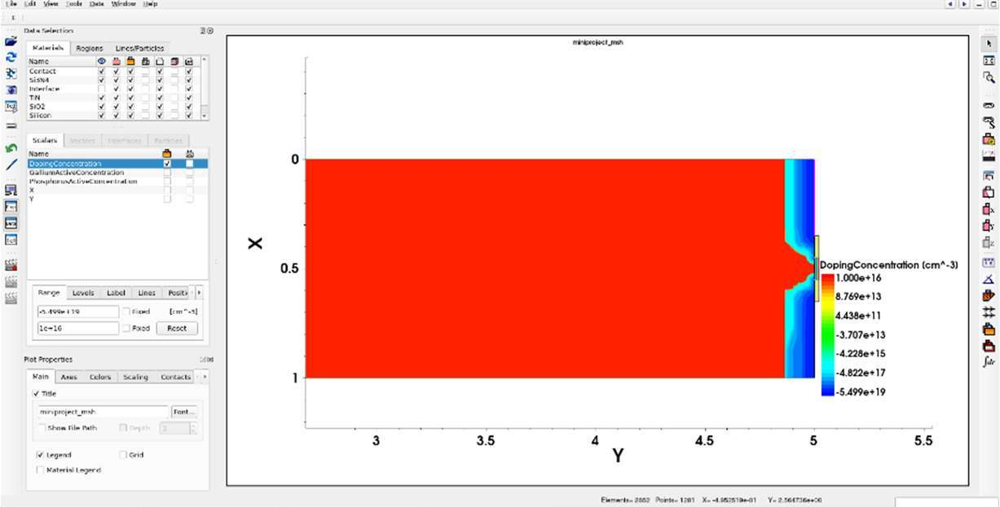
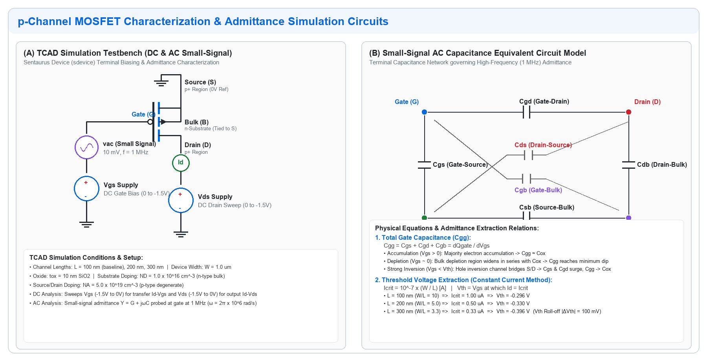
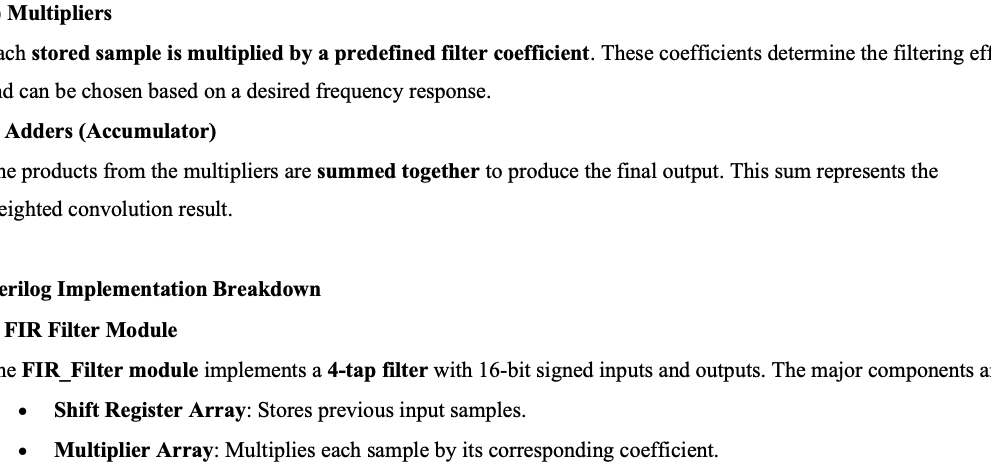
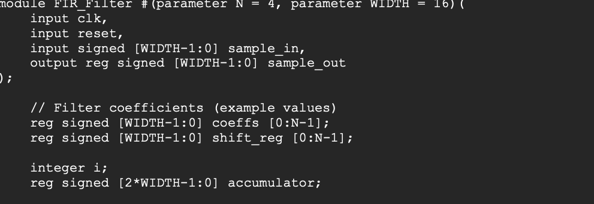
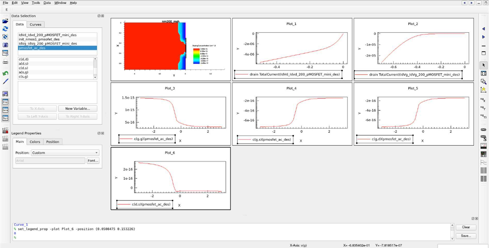
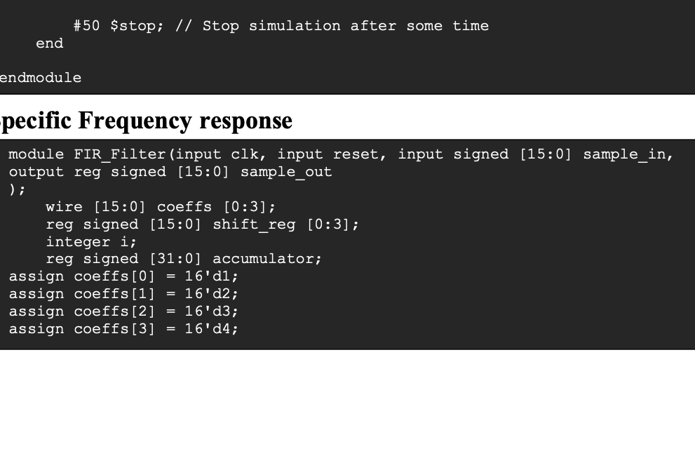
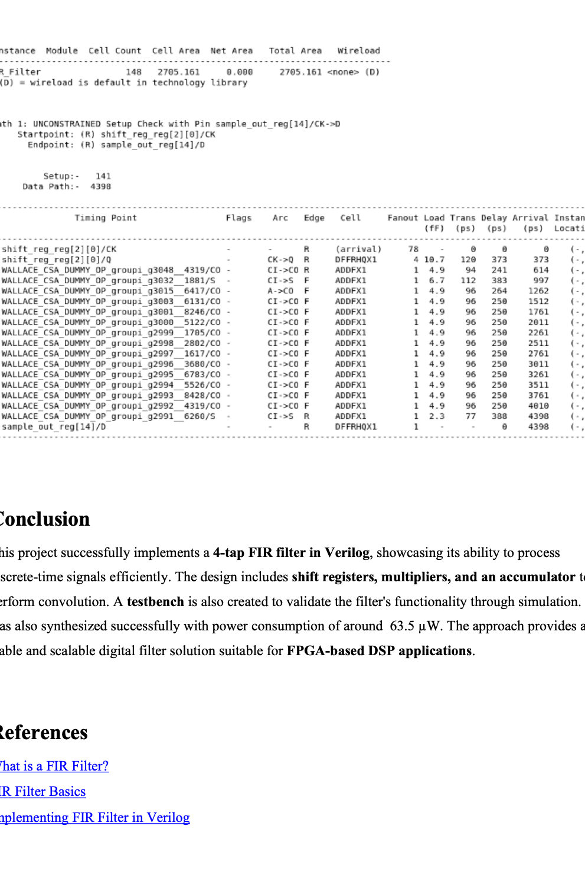

# Design and Characterization of a Sub-Micron p-Channel MOSFET
### Numerical Analysis of DC and AC Characteristics and the Impact of Channel Length Scaling

**Author:** Nikunj Malik  
**Registration Number:** 230959134  
**Toolsuite:** Synopsys Sentaurus TCAD (Structure Editor, sdevice, Inspect, Visual)  
**Date:** 2026  

---

## 1. Abstract

This technical report details the 2D numerical simulation, electrical characterization, and geometric scaling analysis of a sub-micron p-channel Metal-Oxide-Semiconductor Field-Effect Transistor (MOSFET) using the Synopsys Sentaurus TCAD suite. The investigation is divided into two primary thrusts:
1. **Device Characterization:** Comprehensive extraction and analysis of Direct Current (DC) transfer ($I_d-V_{gs}$) and output ($I_d-V_{ds}$) behavior, alongside small-signal Alternating Current (AC) gate capacitance-voltage profiles ($C_{gg}, C_{gs}, C_{gd}, C_{ds}$) at 1 MHz for a baseline 100nm gate-length device.
2. **Channel Length Scaling & Short-Channel Effects (SCE):** Parametric scaling across $L = 300\text{ nm}$, $200\text{ nm}$, and $100\text{ nm}$. Threshold voltages ($V_{th}$) are extracted via the Constant Current Method ($I_{crit} = 10^{-7} \times \frac{W}{L}$).

The numerical results confirm distinct short-channel phenomena: threshold voltage decreases monotonically in magnitude from $-0.396\text{ V}$ ($L = 300\text{ nm}$) to $-0.296\text{ V}$ ($L = 100\text{ nm}$) due to depletion charge sharing and Drain-Induced Barrier Lowering (DIBL).

---

## 2. Device Structure and Simulation Setup

The 2D device structure was modeled with an n-type silicon substrate and heavily doped p-type source/drain extension regions.

*Figure 1: 2D p-MOSFET Sentaurus Visual structure mesh and net active doping concentration distribution ($N_D = 10^{16}\ \text{cm}^{-3}$ n-substrate, $N_A = 5 \times 10^{19}\ \text{cm}^{-3}$ p+ source/drain).*

### Table 1: Device Design & Simulation Parameters
| Parameter | Symbol | Value | Unit |
| :--- | :---: | :---: | :---: |
| **Device Type** | -- | p-channel MOSFET | -- |
| **Channel Length** | $L$ | 100, 200, 300 | $\text{nm}$ |
| **Gate Oxide Thickness** | $t_{ox}$ | 10 | $\text{nm}$ |
| **Substrate (Body) Doping** | $N_D$ (n-type) | $1.0 \times 10^{16}$ | $\text{cm}^{-3}$ |
| **Source/Drain Doping** | $N_A$ (p-type) | $5.0 \times 10^{19}$ | $\text{cm}^{-3}$ |
| **Gate Workfunction** | $\Phi_m$ | 4.80 | $\text{eV}$ |
| **AC Small-Signal Frequency** | $f$ | 1.0 | $\text{MHz}$ |
| **Operating Temperature** | $T$ | 300 | $\text{K}$ |

### Physics Models Activated in Sentaurus Device
* **Transport:** Drift-Diffusion carrier transport.
* **Mobility:** Inversion-layer normal-field degradation (Lombardi surface model) and high-field velocity saturation.
* **Recombination:** Shockley-Read-Hall (SRH) with doping dependency and Auger recombination.
* **Carrier Statistics:** Fermi-Dirac statistics for degenerate source/drain regions.

---

## 3. Circuit Schematics & Testbench Configurations

*Figure 2: (A) TCAD Simulation Testbench circuit for DC voltage sweeps and 1 MHz small-signal AC admittance probing. (B) High-frequency small-signal capacitance equivalent circuit model.*

### Testbench Operations
* **DC Sweeps:** The drain voltage $V_{DS}$ and gate voltage $V_{GS}$ are independently swept from $0\text{ V}$ down to $-1.5\text{ V}$ while holding source and bulk grounded ($V_S = V_B = 0\text{ V}$).
* **AC Admittance Extraction:** At each bias operating point, a small-signal sinusoidal voltage perturbation ($v_{ac} = 10\text{ mV}$ at $1\text{ MHz}$) is superposed at the gate electrode. The resulting complex small-signal currents yield the terminal admittance matrix:
  $$Y_{ij} = G_{ij} + j\omega C_{ij}$$
  where $\omega = 2\pi \times 10^6\ \text{rad/s}$.

---

## 4. Baseline Device Characterization ($L = 100\text{ nm}$)

### 4.1 AC Small-Signal Admittance & Capacitance (1 MHz)

*Figure 3: 1 MHz AC capacitance profiles for 100nm p-MOSFET (Total Gate Capacitance Cgg, Gate-Source Cgs, Gate-Drain Cgd, and Drain-Source Cds).*

* **Total Gate Capacitance ($C_{gg}$):** Exhibits the characteristic MOSFET C-V profile. It is maximal in the accumulation regime ($V_{gs} > 0$), dips in the depletion transition regime, and recovers toward the gate oxide capacitance $C_{ox} = \frac{\epsilon_{ox}}{t_{ox}}$ in strong inversion ($V_{gs} \ll V_{th}$).
* **Gate-Source ($C_{gs}$) & Gate-Drain ($C_{gd}$) Overlap Capacitances:** Near zero when the channel is OFF, limited strictly to parasitic metallurgical overlap capacitance. As inversion hole density accumulates, $C_{gs}$ and $C_{gd}$ rise symmetrically to dominate the total capacitive load.
* **Drain-Source Capacitance ($C_{ds}$):** Remains virtually invariant and minimal across gate bias, reflecting purely reverse-biased p-n junction boundary capacitance.

### 4.2 DC Transfer ($I_d-V_{gs}$) & Output ($I_d-V_{ds}$) Curves

*Figure 4: Sentaurus Visual DC characteristic curves for 100nm p-MOSFET: (Left) Output characteristics Id-Vds; (Right) Transfer characteristics Id-Vgs.*

* **Transfer Characteristics:** Sweeping $V_{gs}$ negatively at fixed $V_{ds}$ transitions the device from the exponential subthreshold regime into strong inversion, yielding a stable saturation current envelope.
* **Output Characteristics:** Sweeping $V_{ds}$ at constant gate overdriven potentials demonstrates an initial linear ohmic region dominated by channel resistance, followed by smooth saturation caused by channel pinch-off at the drain boundary.

---

## 5. Geometric Scaling & Short-Channel Effects (SCE)

### 5.1 Multi-Variable Dashboards for Scaled Devices

*Figure 5: Sentaurus Visual simulation dashboard for L = 200nm p-MOSFET.*

*Figure 6: Sentaurus Visual simulation dashboard for L = 300nm p-MOSFET.*

### 5.2 Threshold Voltage ($V_{th}$) Extraction via Constant Current Method
To ensure rigorous geometric normalization across scaled devices, the critical drain current is defined as:
$$I_{crit} = 10^{-7} \times \frac{W}{L}$$

Assuming an effective width $W = 1.0\ \mu\text{m}$:
* **For $L = 100\text{ nm}$:** $I_{crit} = 10^{-7} \times \frac{1.0\ \mu\text{m}}{0.10\ \mu\text{m}} = 1.00\ \mu\text{A}$ $\implies$ **$V_{th} = -0.296\text{ V}$**
* **For $L = 200\text{ nm}$:** $I_{crit} = 10^{-7} \times \frac{1.0\ \mu\text{m}}{0.20\ \mu\text{m}} = 0.50\ \mu\text{A}$ $\implies$ **$V_{th} = -0.330\text{ V}$**
* **For $L = 300\text{ nm}$:** $I_{crit} = 10^{-7} \times \frac{1.0\ \mu\text{m}}{0.30\ \mu\text{m}} = 0.33\ \mu\text{A}$ $\implies$ **$V_{th} = -0.396\text{ V}$**

*Figure 7: Sentaurus Inspect threshold voltage extraction curves probed at target critical currents: L = 100nm (-0.296V), L = 200nm (-0.330V), and L = 300nm (-0.396V).*

### 5.3 Physical Mechanisms Driving $V_{th}$ Roll-Off
1. **Depletion Charge Sharing:** In long-channel transistors, the gate controls the entire bulk depletion charge below the channel. As $L$ scales to 100nm, the depletion regions associated with the source and drain p-n junctions penetrate a substantial portion of the channel, "sharing" the burden of depleting the substrate. Consequently, a lower gate magnitude $|V_{gs}|$ is required to trigger inversion.
2. **Drain-Induced Barrier Lowering (DIBL):** The proximity of the drain contact permits its electrostatic potential to directly pull down the channel barrier at the source junction, facilitating early hole injection into the channel and increasing off-state leakage.

---

## 6. Conclusion

This simulation study validates fundamental device physics trade-offs inherent to planar CMOS scaling. While shrinking channel length increases device drive current and packing density, it accelerates short-channel degradation (threshold voltage roll-off and electrostatic gate control loss). Managing these phenomena highlights why modern technology nodes transitioned to 3D gate architectures (FinFETs and Gate-All-Around Nanosheets).
